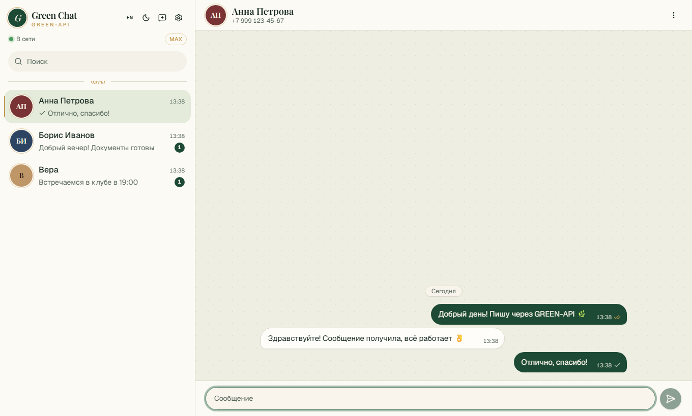
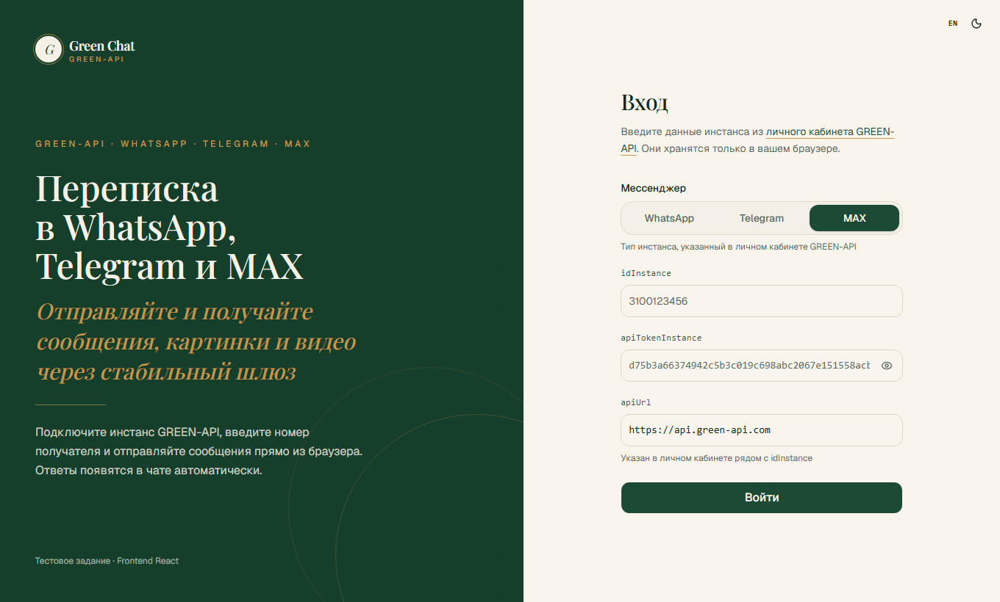
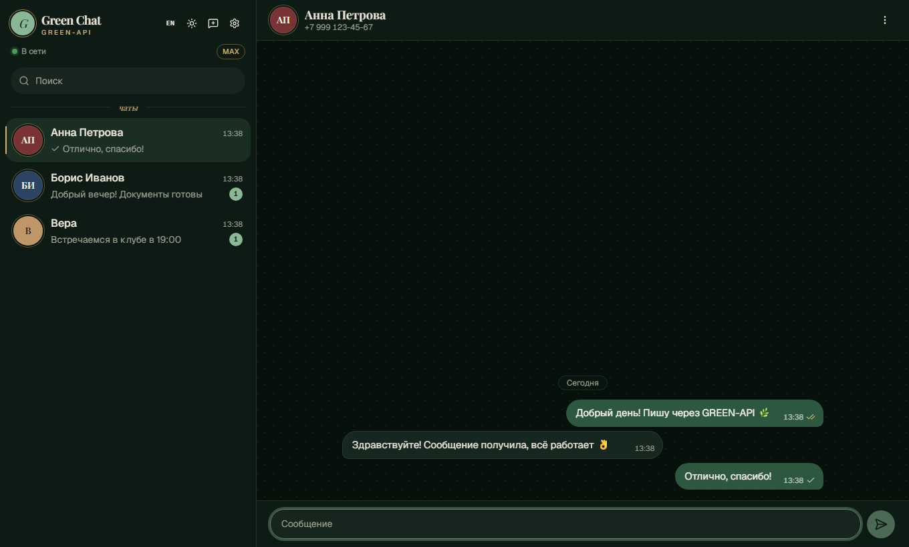

# Green Chat

Веб-интерфейс для отправки и получения текстовых сообщений в **WhatsApp**, **Telegram** и **MAX** через [GREEN-API](https://green-api.com).
Тестовое задание на позицию «Frontend-разработчик React».



| Вход                                      | Тёмная тема                                          |
| ----------------------------------------- | ---------------------------------------------------- |
|  |  |

## Возможности

- Вход по `idInstance` / `apiTokenInstance` (+ `apiUrl` инстанса) с выбором мессенджера инстанса, проверка через `getStateInstance`.
- Создание чата по номеру телефона. Для MAX и Telegram номер проверяется методом `checkAccount`, который возвращает `chatId` пользователя. Для WhatsApp — методом `checkWhatsapp`, а `chatId` имеет вид `79991234567@c.us`.
- Отправка текстовых сообщений методом [`sendMessage`](https://green-api.com/v3/docs/api/sending/SendMessage/) с оптимистичным обновлением и повтором при ошибке.
- Получение сообщений по [HTTP API](https://green-api.com/v3/docs/api/receiving/technology-http-api/): long polling `receiveNotification` → обработка → `deleteNotification`.
- Статусы исходящих (отправлено / доставлено / прочитано) из вебхука `outgoingMessageStatus`.
- Подгрузка последних сообщений чата через `getChatHistory`.
- Входящие от новых собеседников автоматически создают чат, есть счётчик непрочитанных.
- Чаты и сообщения сохраняются в `localStorage` отдельно для каждого инстанса.
- Светлая и тёмная темы, адаптивная вёрстка (на мобильных список чатов и переписка открываются по очереди).
- Интерфейс на русском и английском: переключатель RU/EN на экране входа и в шапке, выбор запоминается.

## Стек

|             |                                                                                                                     |
| ----------- | ------------------------------------------------------------------------------------------------------------------- |
| UI          | React 19, TypeScript, Tailwind CSS v4, shadcn/ui (Radix), lucide                                                    |
| Данные      | TanStack Query v5 (запросы, мутации, long polling), Zod v4 (валидация форм, ответов API и данных из `localStorage`) |
| Локализация | i18next + react-i18next, типизированные ключи, ru / en                                                              |
| Архитектура | [Feature-Sliced Design](https://feature-sliced.design/)                                                             |
| Качество    | ESLint (flat config, правила границ FSD), Prettier (+ сортировка классов Tailwind)                                  |
| Тесты       | Jest + Testing Library (юнит и компоненты), Playwright (e2e, desktop + mobile)                                      |
| Метрики     | web-vitals (CLS, INP, LCP, FCP, TTFB)                                                                               |
| Сборка      | Vite 8                                                                                                              |

## Быстрый старт

Нужен Node.js 20.19+ (или 22+).

```bash
npm install
npm run dev          # http://localhost:5173
```

1. Зарегистрируйтесь в [личном кабинете GREEN-API](https://console.green-api.com), создайте инстанс WhatsApp, Telegram или MAX и авторизуйте его.
2. На экране входа выберите мессенджер инстанса и скопируйте в форму `idInstance`, `apiTokenInstance` и `apiUrl`.
3. Нажмите «Новый чат», введите номер получателя и отправьте сообщение. Для MAX поддерживаются номера +7 и +375, для WhatsApp и Telegram — любые международные.
4. Ответ получателя появится в чате автоматически.

> В настройках инстанса должно быть включено получение уведомлений о входящих сообщениях
> и статусах. Для HTTP API поле `webhookUrl` должно быть пустым, иначе очередь `receiveNotification` не наполняется.

### Скрипты

| Команда                             | Что делает                                                                      |
| ----------------------------------- | ------------------------------------------------------------------------------- |
| `npm run start`                       | dev-сервер Vite                                                                 |
| `npm run build` / `npm run preview` | production-сборка и её локальный просмотр                                       |
| `npm run typecheck`                 | проверка типов `tsc -b`                                                         |
| `npm run lint` / `lint:fix`         | ESLint                                                                          |
| `npm run format` / `format:check`   | Prettier                                                                        |
| `npm test` / `test:coverage`        | юнит-тесты Jest                                                                 |
| `npm run test:e2e`                  | e2e-тесты Playwright (перед первым запуском: `npx playwright install chromium`) |
| `npm run check`                     | typecheck + lint + format + unit одной командой                                 |

E2E-тесты не требуют реального инстанса: GREEN-API эмулируется через `page.route` (`e2e/fixtures/green-api-mock.ts`), включая очередь уведомлений.
Скриншоты для README пересобираются командой `SCREENSHOTS=1 npx playwright test screenshots --project=chromium`.

### Web Vitals

Метрики собираются в `src/shared/lib/web-vitals`. В dev-режиме они выводятся в консоль. Для production используются переменные из `.env.example`:

- `VITE_WEB_VITALS_ENDPOINT` — URL, на который метрики отправляются через `navigator.sendBeacon`;
- `VITE_WEB_VITALS_LOG=true` — вывод в консоль в production-сборке.

## Архитектура (FSD)

```
src/
├── app/            # инициализация: провайдеры (QueryClient, тема, тосты), стили, привязка сторов к инстансу
├── pages/
│   ├── login/      # экран входа
│   └── messenger/  # двухпанельный мессенджер, запуск polling
├── widgets/
│   ├── chat-sidebar/  # шапка, поиск, список чатов, меню аккаунта
│   └── chat-window/   # шапка чата, лента сообщений, композер
├── features/
│   ├── auth/              # вход (getStateInstance) и выход
│   ├── create-chat/       # новый чат по номеру (checkAccount)
│   ├── send-message/      # отправка (sendMessage), optimistic update, повтор
│   ├── receive-messages/  # long polling receiveNotification/deleteNotification, разбор вебхуков
│   ├── load-chat-history/ # getChatHistory
│   ├── switch-language/
│   └── toggle-theme/
├── entities/
│   ├── session/  # учётные данные инстанса + zod-схема
│   ├── chat/     # чаты, телефоны, аватар
│   └── message/  # сообщения, статусы, маппинг ответов API, пузырь сообщения
└── shared/
    ├── api/      # типизированный клиент GREEN-API (fetch + zod), QueryClient
    ├── config/
    ├── i18n/     # i18next, словари ru/en, локализованные ошибки
    ├── lib/      # стор на useSyncExternalStore с персистом, тема, даты, web-vitals
    └── ui/       # компоненты shadcn/ui
```

Правила FSD проверяет ESLint (`no-restricted-imports`): слой импортирует только нижележащие слои, а слайсы подключаются только через публичный API (`index.ts`).

### Решения

- **Получение сообщений.** WebSocket для сообщений у GREEN-API нет: уведомления можно получать только через HTTP API (`receiveNotification`) или через webhook на собственный сервер, а отправка в любом случае идёт обычным HTTP. Поэтому используется long polling через `useQuery`. Задержку перед следующим запросом считает `nextPollDelay`: после уведомления и после честно выдержанного long poll следующий запрос уходит сразу. Если сервер мгновенно вернул пустую очередь (так бывает, например, у неавторизованного инстанса), следующий запрос уходит через 5 с, а при скрытой вкладке — через 15 с. После ошибки пауза 10 с, повторы идут с экспоненциальной задержкой. Параллельных запросов не бывает, TanStack Query их дедуплицирует. Статус соединения берётся из `getStateInstance` и обновляется раз в минуту.
- **Мессенджеры.** Методы GREEN-API одинаковы для WhatsApp, Telegram и MAX: отличается только проверка номера и формат `chatId`. Поэтому мессенджер — поле сессии, а вся разница сосредоточена в `features/create-chat` и в валидации номера.
- **chatId.** У MAX и Telegram `chatId` — это id пользователя, а не номер телефона. Поэтому при создании чата номер сначала проверяется через `checkAccount`. Если метод недоступен, чат создаётся с `<phone>@c.us`, который `sendMessage` тоже принимает. Когда собеседник ответит, чат автоматически переключается на настоящий `chatId` (сопоставление идёт по `senderPhoneNumber`).
- **Гонки.** Вебхук `outgoingAPIMessageReceived` может прийти раньше ответа `sendMessage`. Оптимистичное сообщение тогда сливается с пришедшим. Статусы только растут (sent → delivered → read), поэтому порядок вебхуков не важен.
- **Состояние.** Серверные запросы идут через TanStack Query, локальные данные (чаты, сообщения, сессия, тема) хранятся в маленьком сторе на `useSyncExternalStore`. Данные из `localStorage` перед гидрацией валидируются zod-схемами.
- **Локализация.** Все строки лежат в `src/shared/i18n/locales`. Словарь `ru` задаёт типы, а `en` обязан повторять его структуру, иначе не соберётся TypeScript. Схемы zod и ошибки API возвращают ключи переводов, а не готовый текст, поэтому сообщение переводится в момент показа и меняется вместе с языком. Язык определяется по `localStorage`, затем по настройкам браузера.
